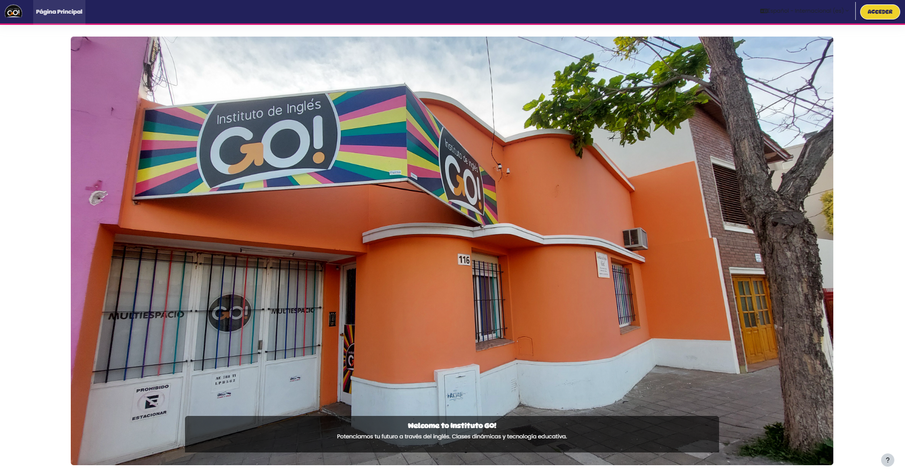
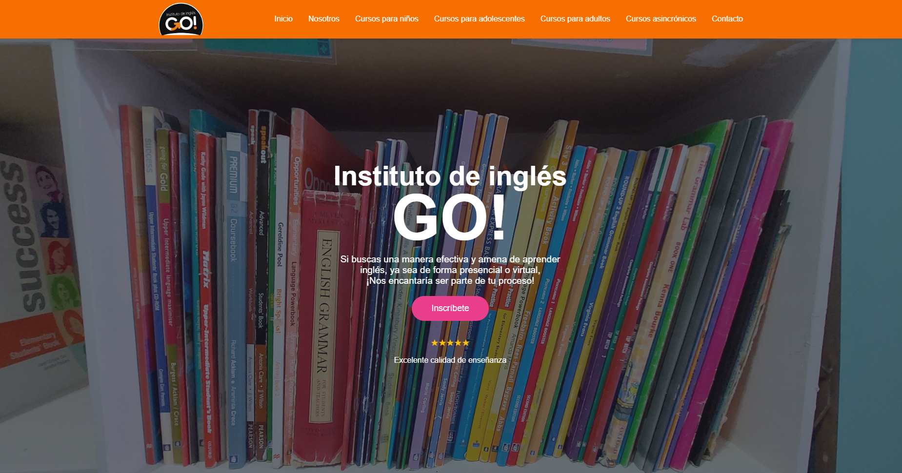
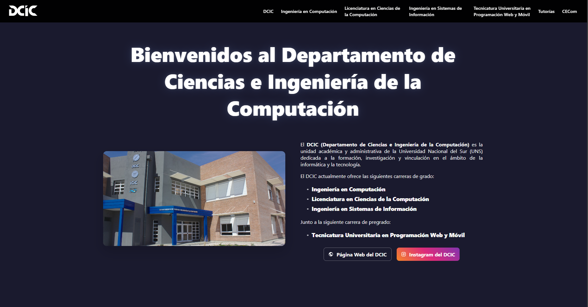

## About me

Computer Science student at Universidad Nacional del Sur (Argentina), graduating in 2027. I build web applications and backend systems, and I'm moving into AI engineering: machine learning, RAG and agents.

**Looking for:** junior backend, fullstack or AI engineering roles. Remote (full-time) or on-site in Bahía Blanca (part-time).

## Work in production

<table>
<tr>
<td width="45%"></td>
<td>
<b>GO! Educación · Moodle campus</b>  
Deployed and configured Moodle on a Linux VPS over SSH, set up the MariaDB database, and trained every teacher on the platform.  
<b>Used by about 250 students and 10 teachers.</b> Course material that used to circulate on WhatsApp now lives in one place.  

  

</td>
</tr>
<tr>
<td width="45%"></td>
<td>
<b>Instituto GO! · Website</b>  
Designed and hand-coded the institute's website from scratch, replacing a site that no longer worked.  
<b>In production since 2025.</b>  

  

<!-- When the repo is public, add:  -->
</td>
</tr>
<tr>
<td width="45%"></td>
<td>
<b>UNS Career Fair · Website</b>  
Built the website for the university's career fair (Muestra de Carreras).  
<!-- Add the stack badges, the live link and the code link here -->
</td>
</tr>
</table>

## Selected projects

<!-- Add each project here once it has a README and a live demo:
- **[Project name](link to repo)** — one line on the problem it solves · stack · [demo](link)
-->

## Tech stack

**Languages** 

**Web** 

**Infrastructure and tools** 

## Teaching

- Teaching assistant in Formal Languages and Automata (ranked 1st in the 2025 selection) and Programming Technology
- Student tutor at the Computer Science department (DCIC-UNS), helping students plan and navigate their degree
- Vice president of the Computer Science student union (CECOM) for two years

## Currently learning

Machine learning (Stanford and DeepLearning.AI specialization), backend architecture and cloud deployment.

